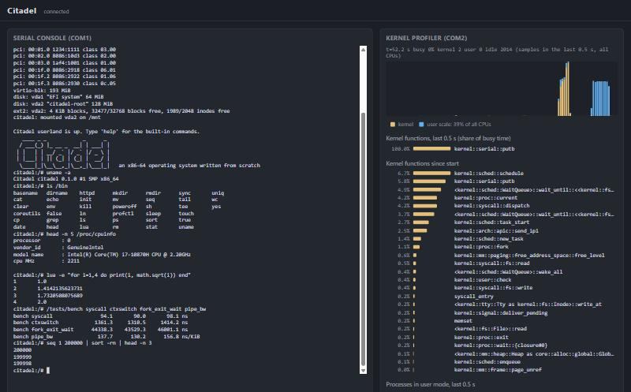

# Citadel

An x86-64 operating system written from scratch: a UEFI boot loader and image tools in Zig, an
SMP kernel in Rust (with its x86 assembly), a C library in C, and a TypeScript web console with a
live kernel profiler. It runs real programs: its own shell and tools, a web server, and the
official Lua 5.4 interpreter, which passes Lua's own test suite on Citadel.

Everything is measured against Linux in the same virtual machine: Alpine's kernel booted in the
same QEMU/KVM configuration, running the **very same static binaries** (Citadel uses the Linux
system-call numbers and ABI, so one build of each program runs on both).

| Part | Language | Lines |
|---|---|---:|
| Kernel (`kernel/`): boot, memory, scheduler, processes, VFS, drivers, network stack | Rust + x86 assembly | 9,800 |
| Hardware-independent kernel logic, tested on the host (`kcore/`): buddy allocator, ELF, cpio, ext2, TCP | Rust | 3,300 |
| C library (`libc/`) | C, assembly | 4,500 |
| Programs (`user/`): init, shell, coreutils, httpd, benchmarks, tests | C | 3,600 |
| UEFI loader (`boot/`), initrd and disk-image builders (`tools/*.zig`) | Zig | 1,100 |
| Web console (`web/`): server, terminal, profiler view, ELF symbols, Rust demangler | TypeScript | 1,200 |

## What it does

**Boot.** OVMF (UEFI firmware) loads `BOOTX64.EFI`, written in Zig, from the FAT32 partition of the
disk image. The loader reads the kernel ELF, the initrd and the command line, places the kernel at
any 2 MiB-aligned address (OVMF occupies the usual 16 MiB), maps the higher half, a direct map of
all RAM and an identity map, collects the memory map and ACPI tables, exits boot services and jumps.

**Kernel** (Rust, `no_std`):
- Per-CPU GDT/TSS/IDT, 256 interrupt stubs generated at build time, `syscall`/`sysret` fast path,
  x2APIC (falls back to xAPIC), IOAPIC, PIT-calibrated LAPIC timer and TSC, ACPI MADT, SMP start-up
  through a 16→32→64-bit trampoline.
- Memory: buddy frame allocator with per-frame reference counts, a size-class heap, four-level page
  tables with copy-on-write `fork`, demand paging, stack growth, **transparent 2 MiB pages** for
  anonymous memory (split on fork, partial `munmap` and `mprotect`), `madvise`, and **lazy TLB**:
  kernel threads keep the last address space loaded, with a generation counter that forces a flush
  when the mappings changed meanwhile.
- Scheduler: per-CPU run queues, work stealing, CPU affinity (`sched_setaffinity`), wait queues with a
  lock-free waiter count, timers.
- Processes: `fork`, `execve` of static ELF files, `wait4`, process groups and sessions, POSIX signals
  with handlers, masks, `sigsuspend` and `sigaltstack`, a terminal line discipline with job control.
- VFS: tmpfs (the root, unpacked from a cpio initrd), devfs, pipes and FIFOs, `/proc` in Linux's
  formats (`ps` reads it on both systems), and **ext2** on a virtio block device.
- Drivers: PCI enumeration, virtio 1.x with MSI-X and `VIRTIO_RING_F_EVENT_IDX`, **virtio-blk** (with
  GPT partitions and a page cache) and **virtio-net** with NAPI-style receive polling.
- Network: Ethernet, ARP, IPv4, ICMP echo, UDP and **TCP** (handshakes, sliding windows, RFC 6298
  retransmission timing, fast retransmit, out-of-order reassembly, delayed ACKs, zero-window probes,
  every close sequence, TIME_WAIT), a loopback path, and BSD sockets (`socket`, `bind`, `listen`,
  `accept4`, `connect` blocking or not, `poll`/`select`, `getsockopt(SO_ERROR)`, ...).
- A sampling profiler (1 kHz per CPU while on) with results in `/proc/profile` or streamed on COM2.

**C library**: program start-up, system calls, strings, `malloc`, stdio with buffering and `popen`,
a `printf` family that converts floating point **exactly** (the double's value is expanded into a big
decimal integer and rounded half-to-even, so output matches glibc digit for digit), a correctly
rounded `strtod`, `scanf`, math on the x87 FPU, time and `strftime`, directories, `getopt`, sockets,
signals, `setjmp`. Checked against glibc on 23,000 formatting and parsing cases: identical output.

**Programs**: `init`, `sh` (pipelines, redirections, `&&`/`||`, background jobs, functions,
`if`/`while`/`for`, `$(...)`, `$((...))`, globbing, job control), a multi-call coreutils (`ls`, `cat`,
`grep` with a small regex engine, `sort`, `wc`, `ps`, `cp`, `mv`, `ln`, ...), `httpd` (a static-file
HTTP/1.1 server with keep-alive, one process, non-blocking sockets and `poll`), Lua 5.4.7, benchmark
and test programs.

**Image tools** (Zig): `mkinitrd` packs a directory into a newc cpio archive; `mkimage` builds the
whole bootable disk: a GPT with an EFI System Partition formatted as FAT32 and a Linux partition
formatted as ext2 (revision 1, 4 KiB blocks), filled from directories. `sgdisk -v`, `fsck.fat -n` and
`e2fsck -fn` find nothing to complain about.

**Web console** (TypeScript, no runtime dependencies): a Node server starts QEMU, connects COM1 (the
console) and COM2 (the profiler stream) to the browser over a hand-written WebSocket implementation,
and names kernel addresses from the kernel's own ELF symbol table with a Rust v0 demangler (checked
against binutils' `c++filt`). The page has a VT100 terminal and a live view: busy share over time,
kernel functions in the last half-second and since the start, and processes in user mode. Sessions
can be recorded and replayed.



*A recorded session replayed in the web console: boot, the shell, Lua, benchmarks. The profile
names the kernel's functions from its own symbol table.*

## Results

All numbers come from the same machine (Intel Core i7-10870H, Windows 11, WSL2 Ubuntu 24.04, QEMU 8.2
with KVM, so the guests run under **nested virtualization**), with 4 virtual CPUs and 1 GiB of memory
for both systems. Linux is Alpine 3.20's `linux-virt` kernel (6.6 LTS) booted directly by QEMU with
Citadel's initrd. Host frequency scaling moves single runs by up to ±10%, so `tools/eval.sh` runs
everything in 3 rounds, alternating the two systems, and the tables show the median of the rounds
(each round's value is itself the median of 7 runs). The full table is in
[results/eval.md](results/eval.md).

### Micro-benchmarks (`user/bench/bench.c`, lower is better)

| benchmark | Citadel | Linux | |
|---|---:|---:|---|
| system call (`getppid`) | 95 ns | 170 ns | 1.80x faster |
| context switch (two processes on one CPU, pipe ping-pong) | 1.39 µs | 1.76 µs | 1.27x faster |
| pipe round trip between two CPUs (wake-up across CPUs) | 29.7 µs | 25.2 µs | 1.18x slower |
| `fork` + `exit` + `wait` | 36.2 µs | 91.6 µs | 2.53x faster |
| `fork` + `exec` + `wait` | 148 µs | 190 µs | 1.28x faster |
| pipe throughput | 161 ns/KiB | 429 ns/KiB | 2.67x faster |
| first touch of anonymous memory, per 4 KiB (both use 2 MiB pages) | 358 ns | 545 ns | 1.52x faster |
| same with `MADV_NOHUGEPAGE` (4 KiB faults) | 1011 ns | 1436 ns | 1.42x faster |
| `open` + `close` | 1021 ns | 1542 ns | 1.51x faster |
| `stat` | 753 ns | 903 ns | 1.20x faster |
| tmpfs write | 66 ns/KiB | 332 ns/KiB | 5.06x faster |

Absolute times move with the host. An earlier full run, made on a quieter host and before a
kernel-stack leak in process exit was fixed, measured most of these 15–25% lower on both systems:
the system call took 79 ns on Citadel and 137 ns on Linux. The ratios were similar, except `fork` +
`exit` + `wait`, which gained most from the fix. Within one run, the system-call times vary by only
a few percent between rounds (Citadel 93–97 ns, Linux 165–178 ns).

The one loss is waking a process on another CPU. Both kernels idle with `hlt`, and the remaining
gap is in the wake-up path under nested virtualization.

These compare a small kernel with a general-purpose one. Linux does much more on these paths:
security mitigations, auditing and accounting hooks, cgroups, namespaces, generic layers for many
file systems and devices, and real multi-threaded process support. Citadel's lead mostly shows how
much that costs, not that Citadel would do Linux's job faster. Where Citadel was slower than Linux
at first, the reasons were concrete and are fixed in the code:
- xAPIC IPIs cost three VM exits (now x2APIC);
- page faults were 4 KiB while Linux used transparent huge pages (now both do);
- each idle→process switch flushed the TLB (now lazy TLB);
- path lookup allocated strings at every step.

### Lua (the same interpreter binary, `rootfs/tests/bench.lua`, best of 3 per round, lower is better)

| workload | Citadel, 3 rounds | Linux, 3 rounds |
|---|---:|---:|
| `fib(30)`: function calls, no system calls | 63.7 – 73.2 ms | 63.1 – 70.8 ms |
| sieve of 3,000,000: one large table | 378 – 449 ms | 344 – 441 ms |
| 300,000 `string.format` + `gmatch`: many small strings | 387 – 475 ms | 438 – 499 ms |

This is the control: user-mode work, where the kernel should not matter. The ranges overlap and
neither system wins consistently: in an earlier full run, Citadel's medians were 3–16% lower, and in
this one `fib` and the sieve were 10–14% higher. The variation comes from the host, not the kernels.
The system-call benchmarks above differ by much more than this noise.

### HTTP (`user/httpd.c` serving a 279-byte page from memory; load from the host with `tools/httpload.c`, 32 keep-alive connections, 10 s, through QEMU's user network)

| | Citadel | Linux | |
|---|---:|---:|---|
| requests per second | 69,608 | 54,982 | 1.27x more |
| latency p50 | 434 µs | 554 µs | 1.28x lower |

(The earlier full run gave 69,951 against 63,588 requests per second.)

The first working version did 14,000 requests per second. The profiler showed the machine 81% idle
under load: the cost was latency, not CPU. The fixes:
- delayed ACKs: one packet per response instead of two;
- notification suppression with `EVENT_IDX`;
- NAPI-style receive, where an interrupt only wakes the network thread, which empties the ring before
  turning interrupts back on.

A scheduler deadlock found on the way is fixed too: two CPUs each waited for the other's task to
finish switching out.

### Correctness

- **Lua 5.4.7's official test suite** (`all.lua`, from lua.org) passes on Citadel: `final OK !!!`,
  including the I/O, `popen`, time, coroutine and garbage-collector tests.
- **ext2**: images made by `mke2fs` are read correctly; every change the driver makes (files up to
  double-indirect blocks, sparse files, truncation, 400-entry directories, renames across
  directories, hard and symbolic links, filling the disk) passes `e2fsck -fn`, on 1 KiB and 4 KiB
  block sizes, in host tests and after the kernel wrote to its own disk in QEMU.
- **TCP** is tested over a simulated link that loses up to 10% of segments, duplicates 5% and
  reorders with jitter, round-tripping every segment through the wire format: transfers arrive
  intact and every connection closes cleanly. Zero windows, refused connections, timeouts and resets
  are covered too.
- **Network** in QEMU (`user/tests/nettest.c`): 4 MiB echo, 200 short connections, refused
  connections, non-blocking connect with `poll`, `getpeername`, UDP. Then `curl` from the host
  fetches pages and a 404 from `httpd` through virtio-net.
- **libc**: identical output to glibc on 23,000 `printf`/`strtod`/`scanf` cases.
- **Open POSIX Test Suite** (from LTP 20240930), 37 interfaces about processes, signals, memory,
  clocks and time: **541 of 547 tests pass on Citadel, exactly as many as on Linux**, with the same
  binaries; see [POSIX results](#posix-results).

### POSIX results

The 37 interfaces in `user/posix/interfaces.txt` have 686 tests. 547 of them compile against
Citadel's headers; the other 139 need threads (`pthread.h`, 106 tests), POSIX shared memory,
message queues, `langinfo.h` and the like. The same 547 static binaries ran on both kernels with
`/tests/posixrun /posix 20`:

| | pass | fail | unresolved | unsupported | untested | hung |
|---|---:|---:|---:|---:|---:|---:|
| Citadel | 541 | 0 | 0 | 4 | 1 | 1 |
| Linux (Alpine 6.6) | 541 | 0 | 0 | 4 | 1 | 1 |

The six that do not pass are the same tests on both systems:
- `nanosleep.10000-1` sleeps longer than the 20-second limit on both.
- The other five report UNSUPPORTED or UNTESTED for optional behaviour.

(Both runs use Citadel's C library, so a library bug shows up on both: `sigismember.5-1` failed on
both until `sigismember` learned to reject invalid signal numbers.)

The first run on Citadel passed 499 tests. The 41 fixes behind the rest:
- stopping and continuing processes (`SIGSTOP`/`SIGTSTP`/`SIGCONT`, `wait` with `WUNTRACED` and
  `WCONTINUED`, `SIGCHLD` with `CLD_STOPPED`/`CLD_CONTINUED` in `si_code`);
- `SA_NOCLDWAIT`;
- blocked signals that are ignored by default staying pending;
- sleeps that go on after a stop and continue;
- per-process user ids and `kill` permissions;
- POSIX record locks;
- `sigaltstack`;
- argument checks on clocks and `fsync`.

## Building and running

Requirements (Linux or WSL2): Rust stable with `rustup target add x86_64-unknown-none`, Zig 0.14.1,
`qemu-system-x86`, `ovmf`, and for the tests `e2fsprogs`, `dosfstools`, `gdisk`, `gcc`, Node.js 18+.

```bash
sh tools/fetch-lua.sh                 # Lua 5.4.7 and its tests from lua.org (checksummed)
sh tools/fetch-posix.sh               # the Open POSIX Test Suite from the LTP release (checksummed)
sh tools/build.sh                     # everything -> build/citadel.img
NET=1 sh tools/qemu-run.sh build/citadel.img   # boots to a shell; http://127.0.0.1:8080 reaches httpd
```

Then try `ls /bin`, `ps`, `cat /proc/meminfo`, `lua`, `httpd &`, `/tests/bench`, `profctl start` and
`cat /proc/profile`. `CMDLINE="console=ttyS0 profile=2" sh tools/build.sh` starts the profiler stream
at boot.

Tests and measurements:

```bash
cd kcore && cargo test --release                       # allocators, ELF, cpio, ext2 vs e2fsck, TCP
sh tools/guest-test.sh 300 /bin/sh /tests/smoke.sh    # any program inside Citadel; exit status out
sh tools/guest-test.sh 300 /tests/nettest
sh tools/guest-test.sh 900 /bin/sh /tests/luatests.sh
sh tools/guest-test.sh 1800 /tests/posixrun /posix 20
ROUNDS=3 sh tools/eval.sh                              # Citadel vs Linux -> results/eval.md
```

The web console:

```bash
cd web && npm install && npm run build && npm test
NET=1 npm start          # http://127.0.0.1:8090, starts QEMU itself (needs profile=2 or profctl stream)
```

## How it fits together

```
boot/            Zig UEFI loader (BOOTX64.EFI)
kernel/src/
  arch/          GDT, IDT, trap entry, syscall entry, APIC, SMP trampoline, per-CPU data
  mm/            frames, heap, page tables, page faults (COW, THP)
  sched.rs       scheduler; proc.rs, exec.rs, signal.rs: processes
  fs/            VFS, tmpfs, devfs, pipes, procfs, ext2 (on kcore::ext2)
  drivers/       PCI, virtio, virtio-blk (+GPT), virtio-net
  net/           IP stack (on kcore::net) and sockets
  syscall/       Linux-numbered system calls
  profile.rs     sampling profiler
kcore/           host-testable logic: buddy, ELF, cpio, path, ext2, TCP
libc/            the C library
user/            init, sh, coreutils, httpd, posix runner, Lua build, tests, benchmarks
tools/           build.sh, qemu-run.sh, linux-run.sh, guest-test.sh, eval.sh,
                 mkinitrd.zig, mkimage.zig, httpload.c, fetch scripts
web/             TypeScript console (server, client, tests)
rootfs/, disk/   files for the initrd and for the ext2 partition
```

## Limitations

- No threads: one thread per process, no `pthread_*`. This also excludes most of the Open POSIX
  Test Suite.
- Static ELF executables only; no dynamic linking.
- No users or permissions: everything runs as root.
- No swapping. File mappings are private copies.
- Only the hardware QEMU's q35 machine presents: OVMF, x2APIC/xAPIC, virtio devices, 16550 UARTs.
  Only the boot CPU takes device interrupts.
- IPv4 only. TCP has no window scaling, SACK or congestion control beyond the receiver's window,
  which is enough on QEMU's user network.
- The C locale only. Time is UTC (no time zone database).

## Third-party code and data

Nothing third-party is compiled into Citadel itself. The build and the tests download:
- Lua 5.4.7 and its test suite (MIT licence), from lua.org;
- the Open POSIX Test Suite, from the Linux Test Project's 20240930 release (GPL-2.0, tests only);
- Alpine 3.20's `vmlinuz-virt` and its `modloop` (for `virtio_net`), for the Linux baseline.

Archives are checked against SHA-256 sums where the scripts fetch them. The web console's
development dependencies are TypeScript and Node's type definitions.

## Licence

MIT, see [LICENSE](LICENSE).
